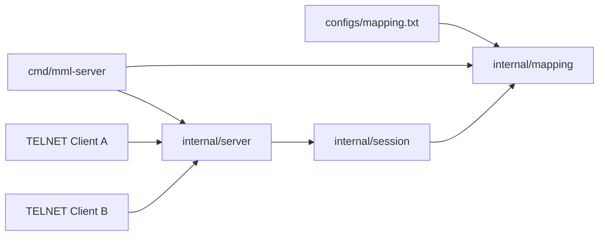
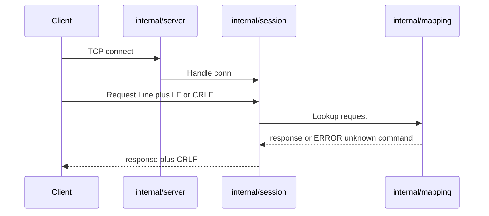
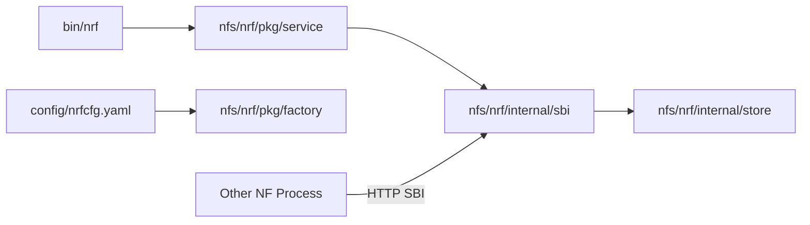

# 架构设计

## 概述

mml-server 是一个基于 TELNET/TCP 的字符串应答服务。运维与联调人员通过 IP 与端口接入后，按行发送请求字符串，服务端依据启动时加载的映射表精确匹配并回写应答。

进程使用 Go 标准库实现监听、会话并发与行协议。每条连接在独立 goroutine 中处理，映射表启动后只读，会话之间无共享可变状态。标准 `telnet` 客户端与裸 TCP 客户端均可按行交互。

默认监听 `0.0.0.0:2323`，默认映射文件为 `configs/mapping.txt`。启动失败（映射缺失、端口占用、端口非法）以退出码 1 结束；SIGINT/SIGTERM 后优雅退出，退出码 0。

## 技术栈

**语言与运行时**
- Go 1.22+（当前环境为 Go 1.25）

**框架**
- 无第三方依赖
- 测试使用 Go 标准库 `testing`

**数据存储**
- 文本映射文件（`request<TAB>response`），启动时一次性加载到内存 `map[string]string`

**基础设施**
- 独立进程，TCP Listen/Accept

**外部服务**
- 无

## 项目结构

```
trea-one/
├── cmd/mml-server/       # mml-server 进程入口
├── internal/mapping/
├── internal/session/
├── internal/server/
├── configs/mapping.txt
├── go.mod                # mml-server module
├── go.work               # 聚合 Go workspace
├── Makefile              # make nrf 构建独立二进制
├── config/nrfcfg.yaml    # NRF 配置样例
├── nfs/nrf/              # NRF 独立 Go module
│   ├── cmd/main.go
│   ├── pkg/factory/
│   ├── pkg/service/
│   ├── internal/store/
│   └── internal/sbi/
└── bin/nrf               # 构建产物
```

**入口点**
- `cmd/mml-server/main.go` - 解析参数、加载映射、注册信号、启动监听

## 子系统

### cmd/mml-server
**目的**: 进程入口与失败退出码
**位置**: `cmd/mml-server/`
**关键文件**: `main.go`
**依赖**: `internal/mapping`、`internal/server`
**被依赖**: 无

### mapping
**目的**: 从文本文件加载精确映射并查询
**位置**: `internal/mapping/`
**关键文件**: `mapping.go`
**依赖**: 无
**被依赖**: `cmd/mml-server`、`internal/server`、`internal/session`

### session
**目的**: 单连接读写循环、IAC 剥离、超限关闭
**位置**: `internal/session/`
**关键文件**: `session.go`
**依赖**: `internal/mapping`
**被依赖**: `internal/server`

### server
**目的**: TCP 监听、并发 Session、优雅退出
**位置**: `internal/server/`
**关键文件**: `server.go`
**依赖**: `internal/mapping`、`internal/session`
**被依赖**: `cmd/mml-server`

### nfs/nrf
**目的**: 独立 NRF 进程，NF 注册、查询与发现
**位置**: `nfs/nrf/`
**关键文件**: `cmd/main.go`、`pkg/service/service.go`、`internal/sbi/server.go`、`internal/store/store.go`
**依赖**: `gopkg.in/yaml.v3`
**被依赖**: 无其他 NF 业务包；运行时仅通过 HTTP SBI 被其他网元调用

NRF 以独立二进制 `bin/nrf` 运行，NF Profile 保存在进程内存中。SIGINT/SIGTERM 后停止本进程 HTTP 服务。不加载 AMF/SMF 等其他 NF 代码。

## 图表






