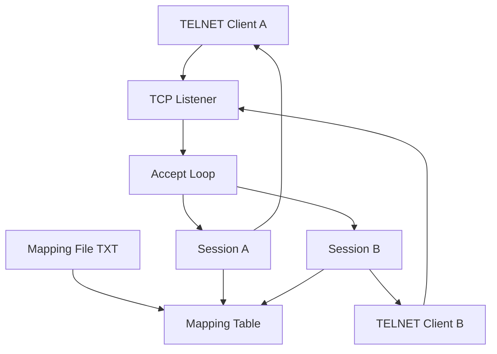

# mml-server Technical Design

Feature Name: mml-server
Updated: 2026-10-26

## Description

mml-server 是一个独立的 Go 进程，在指定 Listen Address 上接受 TELNET 连接。每条连接作为独立 Session，按行读取客户端输入，去掉 LF 或 CRLF 后得到 Request Line，在 Mapping Table 中做整行精确匹配，将对应 Response Line 以 CRLF 写回同一 Session。Mapping Table 在启动时从文本配置文件一次性加载，每行一条 `request<TAB>response`。无匹配时回写固定字符串 `ERROR: unknown command`。

本设计覆盖监听、会话并发、行协议、映射加载与进程退出。TELNET 协商（IAC 选项协商）按“透传可打印文本、忽略协商字节”处理，保证标准 `telnet` 客户端与裸 TCP 客户端均可按行交互。

## Architecture



启动时主进程解析命令行参数、加载 Mapping File、绑定 Listen Address，然后进入 Accept Loop。每条新连接在独立 goroutine 中运行 Session：读行、匹配、写回。Mapping Table 在启动后只读，Session 之间无共享可变状态。

进程收到 SIGINT 或 SIGTERM 后停止 Accept、关闭 Listener 与全部 Session，以退出码 0 结束。

## Components and Interfaces

### 1. `cmd/mml-server`

进程入口。职责：

- 解析 `--host`、`--port`、`--mapping`
- 调用 mapping 加载与 server 启动
- 注册信号并驱动优雅退出
- 将启动失败以非零退出码返回

缺省参数：

| 参数 | 缺省值 |
|------|--------|
| `--host` | `0.0.0.0` |
| `--port` | `2323` |
| `--mapping` | `configs/mapping.txt` |

### 2. `internal/server`

TCP 监听与 Session 生命周期。

```text
type Server struct {
    addr    string
    mapper  *mapping.Table
    listener net.Listener
}

func New(addr string, mapper *mapping.Table) *Server
func (s *Server) ListenAndServe(ctx context.Context) error
```

`ListenAndServe` 在 `ctx` 取消时关闭 listener。Accept 成功后为每个 `net.Conn` 启动 `handleSession`。Listen 失败（含地址占用）直接返回 error，由入口转为非零退出。

### 3. `internal/session`

单连接读写循环。

```text
func Handle(ctx context.Context, conn net.Conn, mapper *mapping.Table)
```

处理步骤：

1. 为 `conn` 设置读超时仅用于检测对端关闭，会话期间保持长连接
2. 使用 `bufio.Reader` 按字节扫描，识别 `\n` 作为行结束；若行尾前一字节为 `\r`，一并剥离
3. 对扫描中累计超过 4096 字节仍未遇到换行的输入，关闭连接并记录超限
4. 将 Request Line 交给 mapper 查找
5. 将结果加上 `\r\n` 写回
6. 读到 EOF 或网络错误时关闭连接并返回

TELNET IAC（`0xFF`）处理：当读到 `0xFF` 时，消费后续 1 或 2 个协商字节，不纳入 Request Line。这样标准 telnet 客户端的选项协商不会污染命令文本。

### 4. `internal/mapping`

映射表加载与查询。

```text
type Table struct {
    items map[string]string
}

func Load(path string) (*Table, error)
func (t *Table) Lookup(request string) string
```

- `Load` 按行读取文本文件。文件缺失返回 error
- 空行与以 `#` 开头的行忽略
- 合法行格式为 `request<TAB>response`；`request` 非空，`response` 允许为空
- 行内无 TAB、或 TAB 左侧为空时，该项跳过并在启动日志中记录
- 重复请求字符串以后出现的项覆盖先出现的项
- `Lookup` 精确匹配；未命中返回 `"ERROR: unknown command"`
- 文件存在但零条合法映射时启动失败

Mapping File 示例：

```text
# request<TAB>response
PING	PONG
HELLO	WORLD
```

### 5. 日志

使用 Go 标准库 `log`。每条 Session 日志带对端地址。记录：接入、断开、超限、网络错误、未匹配（debug 级别不强制，默认 info 仅记录连接级事件）。

## Data Models

### MappingItem

| 字段 | 类型 | 约束 |
|------|------|------|
| request | string | 非空；作为 map key |
| response | string | 可为空字符串，空字符串视为合法应答 |

### Mapping Table 内存结构

`map[string]string`，key 为 Request Line 原文（不含行结束符），value 为 Response Line 原文（不含行结束符）。启动后只读，无需锁。

### Session 运行时

每条 Session 持有：

- `net.Conn`
- `bufio.Reader`
- 对端 `RemoteAddr` 字符串（日志用）

不持久化会话状态。不保存历史请求。

## Correctness Properties

1. 同一 Request Line 在同一 Mapping Table 下每次 Lookup 得到同一 Response Line 或 `ERROR: unknown command`
2. 一条 Session 的读写不影响其他 Session 的连接与应答
3. 行结束符识别：输入 `CMD\n` 与 `CMD\r\n` 得到同一 Request Line `CMD`
4. 应答帧格式固定为 `{response}\r\n`
5. Request Line 长度上限 4096 字节（不含行结束符）；超限关闭该 Session，服务继续接受其他连接
6. Mapping File 加载失败或 Listen 失败时进程不进入 Accept Loop
7. SIGINT / SIGTERM 后进程退出码为 0

## Error Handling

| 场景 | 处理 |
|------|------|
| Mapping File 不存在 | 启动失败，stderr 输出路径与原因，退出码 1 |
| Mapping File 无法按行解析出任何合法映射 | 启动失败，stderr 输出解析错误，退出码 1 |
| Listen Address 占用 | 启动失败，stderr 输出地址与原因，退出码 1 |
| `--port` 非整数或超出 1-65535 | 启动失败，stderr 输出参数错误，退出码 1 |
| Session 网络读错误 / EOF | 关闭该 Session，记录对端与错误，服务继续 |
| Request Line 超 4096 字节 | 关闭该 Session，记录超限，服务继续 |
| Session 写回失败 | 关闭该 Session，记录对端与错误，服务继续 |
| 单条映射行无 TAB 或 request 为空 | 跳过该行并记日志；其余合法行仍加载 |
| 进程信号 | 取消 root context，关闭 listener 与连接，退出码 0 |

## Test Strategy

### 单元测试

- `mapping.Load`：合法文件、缺失文件、空文件、重复 key 后者覆盖、无 TAB 行跳过、`#` 注释与空行忽略
- `mapping.Lookup`：命中、未命中返回 `ERROR: unknown command`、空字符串请求
- 行扫描：`\n`、`\r\n`、连续两行、超 4096 字节

### 集成测试

- 启动真实 TCP 监听（随机端口），用 `net.Dial` 发送 `PING\n`，断言读回 `PONG\r\n`
- 发送 `PING\r\n`，断言与 `\n` 情况相同
- 发送未配置命令，断言 `ERROR: unknown command\r\n`
- 两个并发客户端交叉发送，各自收到对应应答
- 一端断开后另一端仍可交互
- 占用端口再启动，进程退出码非 0

### 手工验证

```bash
# 启动
go run ./cmd/mml-server --host 127.0.0.1 --port 2323 --mapping configs/mapping.txt

# 连接
telnet 127.0.0.1 2323
```

输入 Mapping File 中的 request，应看到对应 response。

## Project Layout

```text
cmd/mml-server/main.go
internal/server/server.go
internal/session/session.go
internal/mapping/mapping.go
configs/mapping.txt
go.mod
```

模块路径使用 `mml-server`。Go 版本与仓库环境一致，优先 1.22+。

## Implementation Notes

- 使用标准库：`net`、`bufio`、`flag`、`os/signal`、`context`、`strings`
- 不引入第三方依赖
- Session goroutine 通过 `sync.WaitGroup` 纳入 Server，便于优雅退出等待在途读写结束（等待上限 3 秒，超时后直接 Close 连接）
- 不实现 TELNET 全量 RFC；仅剥离 IAC，满足“可用 telnet 客户端按行收发字符串”

## References

[^1]: (RFC 854) - [TELNET Protocol Specification](https://datatracker.ietf.org/doc/html/rfc854)
[^2]: (Go net) - [Package net](https://pkg.go.dev/net)
