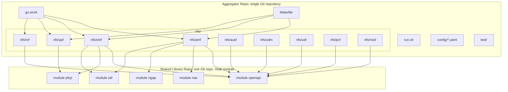
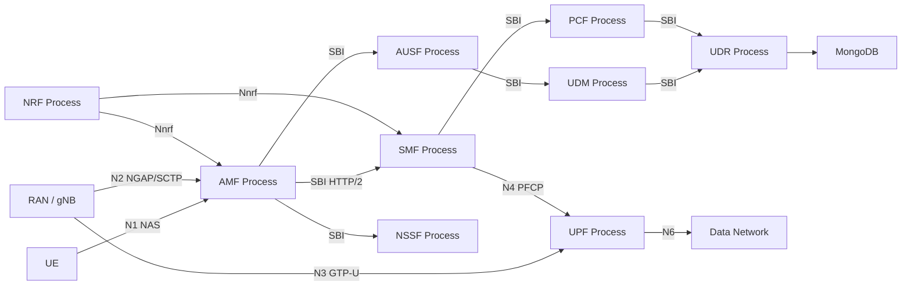

# 将 free5GC 按网元拆分为独立工程

Feature Name: split-free5gc-nfs
Updated: 2026-10-28

## Description

将 free5GC 核心网按 NF 拆分为同一 Git 仓库内的多个独立 Go module，每个 In-Scope NF 产出独立可执行文件并以独立操作系统进程运行。NF 之间只通过 3GPP 接口通信：控制面走 HTTP/2 SBI（经 NRF 注册与发现），SMF 与 UPF 走 N4/PFCP，AMF 与 RAN 走 N2/NGAP，UPF 用户面走 N3/GTP-U 与 N6。

本轮 In-Scope NF：AMF、SMF、UPF、NRF、AUSF、UDM、UDR、PCF、NSSF。Out-of-Scope：CHF、NEF、BSF、N3IWF、TNGF、WebConsole。

协议编解码、OpenAPI 模型与公共工具放入独立 Shared Library Git 仓库，仓内以多个 Go module（`openapi`、`nas`、`ngap`、`pfcp`、`util`）共存，各 NF module 以 `go.mod` 分别依赖所需 module。聚合仓根目录只保留编排、配置样例、集成测试、文档与 `go.work`。

当前工作区尚未包含 free5GC 源码。实施时以官方 free5GC 仓库（`github.com/free5gc/free5gc` 及其 `NFs/<nf>` 子模块、`github.com/free5gc/{openapi,nas,ngap,pfcp,util}`）为输入，迁入本仓库的 `nfs/<nf>/` 与独立 Shared Library 仓。

## Architecture





运行时每个 `nfs/<nf>` 构建出 `bin/<nf>`，由编排脚本按进程拉起。任一 NF 进程退出不影响其余进程。控制面 NF 启动后向 NRF 注册；对端 NF 通过 NRF 发现后再发起 SBI 调用。

推荐启动顺序：MongoDB -> NRF -> UDR -> UDM -> AUSF -> NSSF -> PCF -> AMF -> SMF -> UPF。

## Components and Interfaces

### 1. Aggregator Repo 根目录

职责：工作区编排、构建、联调，不含 NF 业务实现。

| 路径 | 职责 |
|------|------|
| `go.work` | 将 `nfs/amf` 等 9 个 module 纳入同一 Go Workspace |
| `Makefile` | `make nfs` 分别进入各 module 构建 `bin/<nf>` |
| `run.sh` | 按顺序 `exec` 各 `bin/<nf> -c config/<nf>cfg.yaml` |
| `force_kill.sh` | 按进程名或 PID 文件停止各 NF Process |
| `config/` | 各 NF 的 YAML 样例，语义对齐 free5GC |
| `test/` | 端到端集成测试；测试进程与 NF 进程分离 |
| `nfs/<nf>/` | 各 NF Project |

根目录禁止出现 `internal/` 业务包或同时编译多个 NF 的单一 `main`。

### 2. NF Project：`nfs/<nf>/`

每个 In-Scope NF 一个 Go module。目录约定对齐 free5GC：

```text
nfs/amf/
  go.mod
  cmd/main.go
  internal/context/
  internal/sbi/
  internal/ngap/
  pkg/factory/
  pkg/service/
```

`go.mod` 约束：

- module 路径形如 `github.com/<org>/free5gc/nfs/amf`（实施时以实际 module 前缀为准）
- 允许依赖 Shared Library
- 禁止 `require` 其他 In-Scope NF 的业务 module
- 禁止 import 其他 `nfs/<x>/internal` 或 `nfs/<x>/pkg` 中的业务流程包

`cmd/main.go` 只启动本 NF：解析本 NF 配置、初始化本 NF context、拉起本 NF 的 SBI/N2/N4 服务、处理 SIGINT/SIGTERM。

构建：

```bash
# 在 nfs/amf 内构建 AMF 可执行文件
CGO_ENABLED=0 go build -o ../../bin/amf ./cmd
```

UPF 若依赖 `gtp5g` 内核模块或 CGO，允许该 module 单独开启 CGO；其余控制面 NF 默认 `CGO_ENABLED=0`。

### 3. Shared Library 独立仓库

一个 Git 仓库，仓内多个 Go module，目录建议：

```text
shared/
  go.work
  openapi/go.mod
  nas/go.mod
  ngap/go.mod
  pfcp/go.mod
  util/go.mod
```

| Module | 内容 | 典型消费者 |
|--------|------|------------|
| `openapi` | SBI OpenAPI 模型、HTTP/2 客户端辅助 | 全部 Control Plane NF |
| `nas` | NAS 编解码 | AMF |
| `ngap` | NGAP 编解码 | AMF |
| `pfcp` | PFCP 编解码 | SMF、UPF |
| `util` | logger、httpwrapper、mongoapi、idgenerator、fsm | 各 NF |

约束：

- 仓库内不提供 `cmd/` NF 入口
- 不包含 AMF/SMF 等业务流程
- 仓内 module 之间允许依赖（例如 `util` 依赖 `nas` 做 metrics），禁止反向依赖任一 NF Project
- 版本通过 Git tag 整仓发布；Aggregator 内用 `go.work` 的 `use` 或各 `nfs/<nf>/go.mod` 的 `replace` 指向本地 Shared Library 检出以便联调

### 4. 进程与接口

| NF | 进程入口 | 对外接口 | 配置文件 |
|----|----------|----------|----------|
| NRF | `bin/nrf` | Nnrf HTTP/2 SBI | `config/nrfcfg.yaml` |
| AMF | `bin/amf` | Namf SBI、N2 NGAP/SCTP、N1 NAS | `config/amfcfg.yaml` |
| SMF | `bin/smf` | Nsmf SBI、N4 PFCP | `config/smfcfg.yaml` |
| UPF | `bin/upf` | N4 PFCP、N3 GTP-U、N6 | `config/upfcfg.yaml` |
| AUSF | `bin/ausf` | Nausf SBI | `config/ausfcfg.yaml` |
| UDM | `bin/udm` | Nudm SBI | `config/udmcfg.yaml` |
| UDR | `bin/udr` | Nudr SBI，后端 MongoDB | `config/udrcfg.yaml` |
| PCF | `bin/pcf` | Npcf SBI | `config/pcfcfg.yaml` |
| NSSF | `bin/nssf` | Nnssf SBI | `config/nssfcfg.yaml` |

SBI 默认端口语义沿用 free5GC（各 NF 在本 NF YAML 的 `sbi.port` / `sbi.bindingIPv4` 中声明）。NF 之间发现使用配置项 `nrfUri`。

`run.sh` 为每个 NF 使用独立 `exec` 或后台进程 + PID 文件，禁止在同一 Go `main` 里 `go amf.Start(); go smf.Start()`。

### 5. 关键接口契约

**NF Project 进程入口**

```text
func main()
  factory.InitConfigFactory(cfgPath) error
  service.Start() error
  service.Terminate()
```

**SBI 注册（Control Plane NF）**

启动成功后调用 NRF `Nnrf_NFManagement` 注册 `NFProfile`（nfType、nfInstanceId、sbi 地址、serviceList）。退出前注销。

**N4（SMF <-> UPF）**

SMF 作为 PFCP CP，UPF 作为 PFCP UP。会话建立/修改/释放走 PFCP Session Establishment/Modification/Deletion。拆分后双方只通过 UDP PFCP 报文交互。

**N2（RAN <-> AMF）**

AMF 监听 SCTP NGAP。NAS 消息在 NGAP 中承载。AMF 进程内完成 NAS 编解码，对 SMF 的会话相关请求经 SBI 发出。

## Data Models

### NF 工程清单

```text
type NfId string  // amf | smf | upf | nrf | ausf | udm | udr | pcf | nssf

type NfProject struct {
    Id         NfId
    ModulePath string  // nfs/<id>
    Binary     string  // bin/<id>
    Config     string  // config/<id>cfg.yaml
}
```

### 配置（沿用 free5GC YAML 语义）

各 NF YAML 至少包含本 NF 相关项：

| 字段 | 所属 NF | 含义 |
|------|---------|------|
| `sbi.scheme` / `sbi.port` / `sbi.bindingIPv4` / `sbi.registerIPv4` | Control Plane NF | SBI 绑定与注册地址 |
| `nrfUri` | Control Plane NF | NRF 根 URI |
| `ngapIpList` / `ngapPort` | AMF | N2 监听 |
| `pfcp.nodeID` / `pfcp.listenAddr` | SMF、UPF | N4 |
| `mongodb.url` / `mongodb.name` | UDR | 订阅数据存储 |
| `snssaiInfos` / `userplaneInformation` | SMF | DNN、UPF 拓扑 |
| `servedGuamiList` / `supportTaiList` | AMF | 服务区域 |

拆分不改变字段语义；仅改变配置文件的归属路径（样例集中在聚合仓 `config/`，NF 也可携带 `nfs/<nf>/config/` 默认文件）。

### NFProfile（NRF）

控制面 NF 注册到 NRF 的逻辑模型与 3GPP TS 29.510 对齐：`nfInstanceId`、`nfType`、`nfStatus`、`plmnList`、`sNssais`、`nfServices[]`（serviceName、schema、ipEndPoints）。

### 进程清单（编排）

```text
type ProcSpec struct {
    Nf     NfId
    Bin    string
    Args   []string  // ["-c", "config/amfcfg.yaml"]
    PidFile string
}
```

## Correctness Properties

1. **进程一一对应**：同一时刻每个已启动 In-Scope NF 对应恰好一个本 NF 的 NF Process；不存在包含两个以上 NF 业务入口的进程。
2. **模块无互引**：`nfs/<a>` 的业务包不被 `nfs/<b>` import；跨 NF 只允许 Shared Library 与网络协议。
3. **共享库无进程**：Shared Library 仓库构建产物为 Go 包，不产出 `bin/amf` 这类 NF 二进制。
4. **故障隔离**：杀死 `bin/amf` 后 `bin/smf`、`bin/upf` 等进程仍处于运行状态（直至其自身依赖超时）。
5. **独立构建**：在仅检出 `nfs/amf` + Shared Library 的情况下，AMF 可完成 `go build`。
6. **配置隔离**：修改 `config/amfcfg.yaml` 并仅重启 AMF 进程后，新 SBI/N2 参数在 AMF 生效，其他 NF 配置保持原值。
7. **接口守恒**：拆分不改变 N1/N2/N3/N4/N6/SBI 的协议与消息语义。
8. **范围守恒**：`nfs/` 下本轮只出现 9 个 In-Scope NF 目录。

## Error Handling

| 场景 | 处理 |
|------|------|
| 本 NF 配置文件缺失或 YAML 非法 | 该 NF Process 打印可定位错误（含 NF 名与路径），以非零码退出；编排脚本记录失败并继续或按策略停止后续 NF |
| 本 NF 监听地址占用 | 该 NF Process 非零退出；其余已启动 NF 保持运行 |
| NRF 不可达 | 控制面 NF 按 free5GC 既有重试/失败逻辑处理注册；进程保持独立，不改为拉起 NRF |
| 对端 NF 进程已退出 | 调用方收到 SBI/PFCP 超时或连接错误，按 3GPP/既有实现返回失败；不在本进程内“补跑”对端 NF |
| Shared Library 版本不匹配 | `go build` / `go mod tidy` 失败，阻止产出二进制 |
| 集成测试误在测试进程内 import NF 业务并直接调用 | 视为违规；测试必须通过启动 `bin/<nf>` 或网络接口交互 |
| SIGINT/SIGTERM | 仅当前收到信号的 NF Process 停止本 NF 服务并退出 |
| UDR 连不上 MongoDB | UDR 进程启动失败并非零退出 |

## Test Strategy

### 单元测试

每个 `nfs/<nf>` 内 `go test ./...`，覆盖本 NF 的 factory、context、handler。测试允许使用 Shared Library，禁止启动其他 NF 进程作为隐式依赖（对端用 httptest/假 PFCP 节点替换）。

### 构建隔离测试

1. 仅对 `nfs/amf` 执行 `go build`，断言成功。
2. 用 `go list` / 静态检查断言 `nfs/amf` 的 import 图不包含 `nfs/smf` 等其他 NF 路径。
3. 断言 Shared Library 仓库无 `cmd` 产出 NF 二进制。

### 进程隔离测试

1. 启动 NRF、AMF、SMF 三个进程，记录 PID。
2. 向 AMF 发送 SIGTERM，断言 SMF 与 NRF 的 PID 仍存活。
3. 断言系统中不存在命令行同时包含多个 NF 入口的单一进程。

### 接口联调测试

聚合仓 `test/` 启动 9 个 NF 进程 + MongoDB，使用既有 NAS/NGAP 测试夹具验证：

- UE 注册（AMF-AUSF-UDM-UDR-NRF-NSSF）
- PDU Session 建立（AMF-SMF-PCF-UPF N4）
- NRF 注册与发现

测试进程只作为 UE/RAN 模拟器，不链入 NF 业务包作为 in-process 实现。

### 配置兼容测试

用 free5GC 语义的样例 YAML 启动各 NF，断言 SBI 端口、`nrfUri`、NGAP/PFCP 地址按文件生效。

## Implementation Notes

迁移顺序建议：

1. 建立 Shared Library 仓，迁入 `openapi`、`nas`、`ngap`、`pfcp`、`util`。
2. 在 Aggregator 建立 `go.work` 与 `nfs/` 空 module。
3. 按依赖从低到高迁入：NRF -> UDR -> UDM -> AUSF -> NSSF -> PCF -> AMF -> SMF -> UPF。
4. 每迁入一个 NF：独立 `go build`、单元测试、import 边界检查。
5. 最后接 `run.sh` 与注册/PDU 集成测试。
6. 删除聚合根目录残留的 NF 业务源码。

本地联调 Shared Library：在各 `nfs/<nf>/go.mod` 使用 `replace` 指向 Shared Library 仓路径，或在 `go.work` 中 `use` 该仓 module。

## References

[^1]: (Website) - [free5GC System Architecture](https://deepwiki.com/free5gc/free5gc/1.1-system-architecture)
[^2]: (Website) - [free5GC Network Functions Overview](https://deepwiki.com/free5gc/free5gc/1.2-network-functions-overview)
[^3]: (Website) - [free5GC Build System](https://deepwiki.com/free5gc/free5gc/2.1-build-system)
[^4]: (Website) - [3GPP TS 23.501 5G System Architecture](https://www.3gpp.org/ftp/Specs/archive/23_series/23.501/)
[^5]: (Website) - [github.com/free5gc/util](https://pkg.go.dev/github.com/free5gc/util)
[^6]: (Website) - [github.com/free5gc/openapi](https://pkg.go.dev/github.com/free5gc/openapi)
